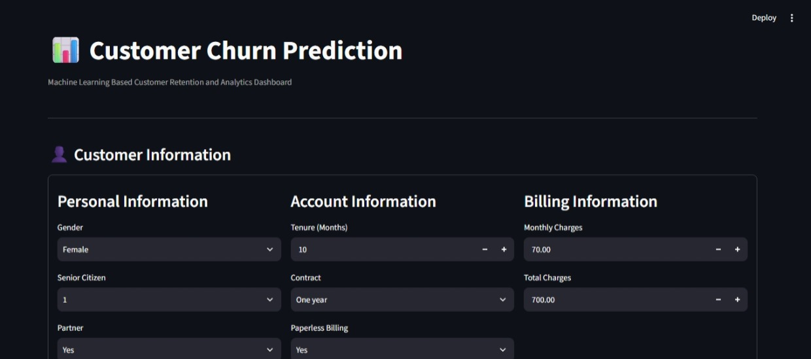
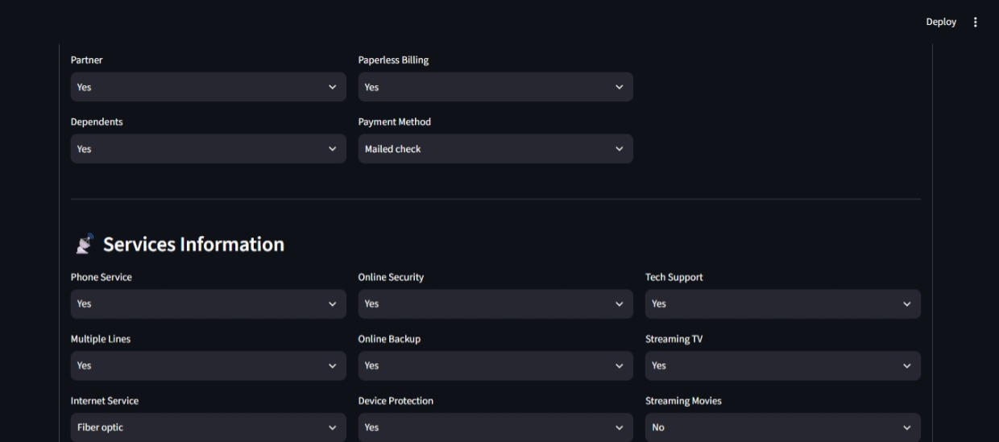
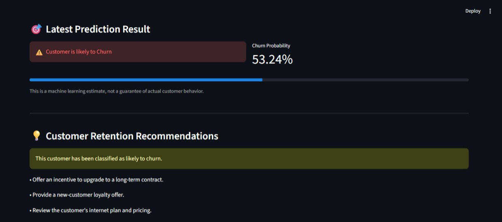
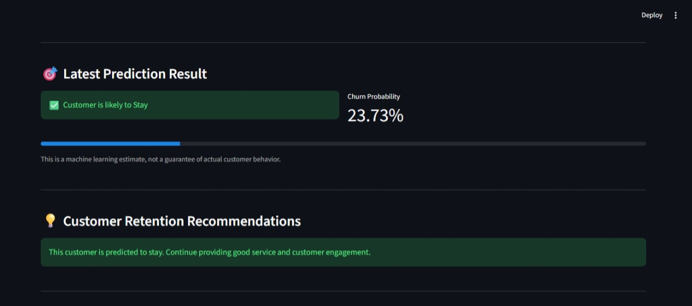
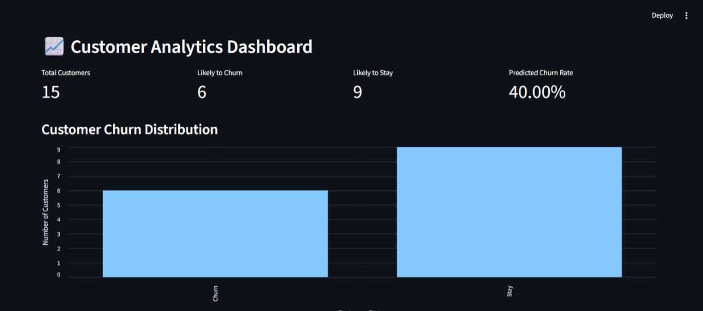
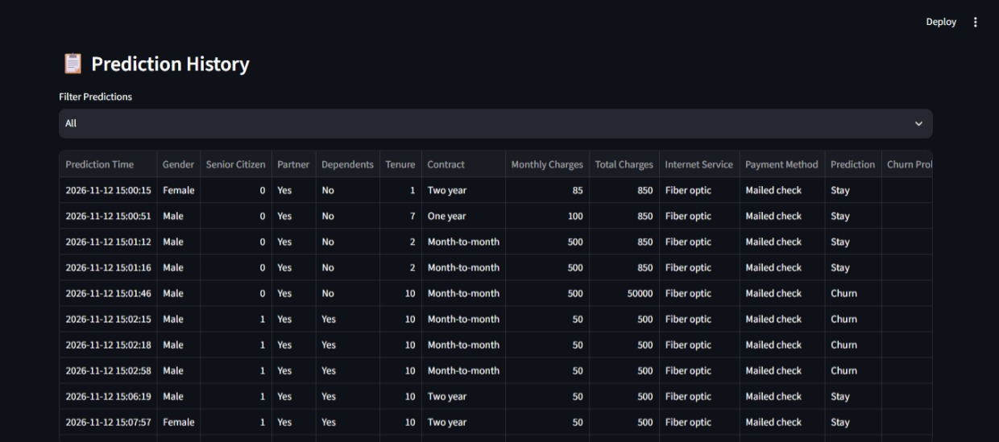
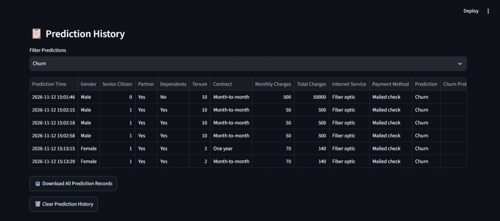

# Customer Churn Prediction Using Machine Learning

<p align="center">
  <strong>Machine Learning-Based Customer Retention and Analytics Dashboard</strong>
</p>

## 1. Project Overview

Customer churn is a significant challenge for subscription-based businesses, as customer attrition can negatively impact revenue, profitability, and long-term growth. Identifying customers who are likely to discontinue their services enables businesses to take proactive retention measures.

This project develops an end-to-end machine learning solution to analyze customer behavior, identify churn patterns, and predict customer churn using historical customer data.

Multiple classification algorithms are trained and evaluated to identify a suitable predictive model. A Streamlit application is developed to provide interactive churn predictions, probability estimates, customer retention recommendations, prediction history, and analytics.

## 2. Business Problem

Businesses often struggle to identify customers who are likely to leave before they discontinue their services.

Without an effective churn prediction system, companies may miss opportunities to retain customers and reduce customer acquisition costs.

This project addresses the problem by analyzing historical customer information and developing a machine learning model that estimates the likelihood of customer churn.

## 3. Project Objectives

- Analyze customer information to identify churn patterns.
- Perform exploratory data analysis to understand customer behavior.
- Clean and preprocess customer data.
- Perform feature engineering and feature selection.
- Build multiple machine learning classification models.
- Evaluate models using appropriate performance metrics.
- Compare classification algorithms and select a suitable final model.
- Develop an interactive Streamlit churn prediction application.
- Estimate churn probability for individual customers.
- Provide rule-based customer retention recommendations.
- Implement prediction history and analytics functionality.

## 4. Dataset Description

The project uses the Telco Customer Churn dataset.

### Dataset Information

| Attribute | Description |
|---|---|
| Dataset | Telco Customer Churn |
| Total Records After Preprocessing | 7,032 |
| Target Variable | Churn |
| Target Classes | Yes / No |
| Numerical Features | 4 |
| Categorical Features | 15 |
| Problem Type | Binary Classification |

### Target Distribution

| Customer Category | Count | Percentage |
|---|---:|---:|
| No Churn | 5,163 | 73.42% |
| Churn | 1,869 | 26.58% |
| Total | 7,032 | 100% |

The dataset contains customer demographics, account information, billing details, contract information, and subscribed services.

## 5. Technologies Used

| Technology | Purpose |
|---|---|
| Python | Programming language |
| Pandas | Data manipulation and analysis |
| NumPy | Numerical operations |
| Matplotlib | Data visualization |
| Seaborn | Statistical visualization |
| Scikit-learn | Machine learning and preprocessing |
| Streamlit | Interactive web application |
| Joblib | Model and preprocessing object persistence |
| Jupyter Notebook | Data analysis and model development |

## 6. Project Workflow

The project follows an end-to-end machine learning workflow.

1. Project Setup
2. Business Problem Understanding
3. Data Loading
4. Data Understanding
5. Exploratory Data Analysis
6. Data Cleaning and Preprocessing
7. Feature Engineering
8. Feature Selection
9. Train-Test Split
10. Encoding Categorical Variables
11. Feature Scaling
12. Model Building
13. Model Evaluation
14. Model Comparison
15. Hyperparameter Tuning
16. Final Model Selection
17. Model Saving
18. Streamlit Deployment
19. Project Documentation

## 7. Exploratory Data Analysis

Exploratory Data Analysis was performed to understand customer characteristics, identify churn patterns, and examine relationships between customer attributes and churn.

### Key Findings

- Customers with shorter tenure tend to have higher churn rates.
- Month-to-month contract customers exhibit higher churn rates.
- Customers with long-term contracts generally demonstrate lower churn rates.
- Electronic check payment customers show higher churn tendencies.
- Customers without online security and technical support tend to have higher churn rates.
- Churn rates generally decrease as customer tenure increases.

### Tenure-Based Churn Analysis

| Tenure Group | Churn Percentage |
|---|---:|
| 0–12 Months | 47.68% |
| 13–24 Months | 28.71% |
| 25–48 Months | 20.39% |
| 49–60 Months | 14.42% |
| 60+ Months | 6.61% |

These observations indicate that customer tenure and contract characteristics are important factors associated with customer churn.

## 8. Data Preprocessing

The following preprocessing operations were performed:

- Converted `TotalCharges` into numerical format.
- Identified and handled missing values.
- Created tenure groups for exploratory analysis.
- Separated numerical and categorical features.
- Removed unnecessary columns from model training.
- Split the dataset into training and testing sets.
- Applied One-Hot Encoding to categorical variables.
- Applied StandardScaler to continuous numerical features.
- Prepared transformed features for machine learning algorithms.

### Train-Test Split

| Dataset | Records |
|---|---:|
| Training Set | 5,625 |
| Testing Set | 1,407 |
| Total | 7,032 |

The fitted encoder and scaler were saved using Joblib to ensure consistent preprocessing during deployment.

## 9. Machine Learning Models

The following classification algorithms were developed and evaluated:

### Logistic Regression

Used as a linear classification model to estimate customer churn probability.

### Decision Tree Classifier

Used to identify decision rules and patterns associated with customer churn.

### Random Forest Classifier

Used an ensemble of decision trees to improve predictive performance and capture nonlinear relationships.

### Balanced Logistic Regression

Used class balancing to improve the model's ability to identify churn customers and increase churn recall.

## 10. Model Evaluation

The models were evaluated using the following performance metrics:

- Accuracy
- Precision
- Recall
- F1-Score
- ROC-AUC
- Confusion Matrix

### Model Comparison

| Model | Accuracy | Precision | Recall | F1-Score | ROC-AUC |
|---|---:|---:|---:|---:|---:|
| Logistic Regression | 80.45% | 64.95% | 57.49% | 0.61 | 0.8359 |
| Decision Tree | 73.06% | 49.34% | 49.73% | 0.50 | 0.6565 |
| Random Forest | 78.75% | 63.07% | 48.40% | 0.55 | 0.8137 |
| Balanced Logistic Regression | 72.49% | 48.93% | 79.68% | 0.61 | 0.8352 |

*Precision, Recall, and F1-Score represent the churn-positive class. Values are rounded.*

### Model Comparison Insights

- Logistic Regression achieved the highest accuracy among the evaluated models.
- Logistic Regression achieved the highest ROC-AUC.
- Balanced Logistic Regression achieved substantially higher churn recall.
- Decision Tree demonstrated comparatively lower predictive performance.
- Random Forest achieved competitive accuracy but lower churn recall than Logistic Regression.

## 11. Final Model Selection

**Logistic Regression was selected as the final model.**

The model was selected based on its overall accuracy, ROC-AUC, and balanced performance across the evaluated metrics.

### Final Model Performance

| Metric | Score |
|---|---:|
| Accuracy | 80.45% |
| ROC-AUC | 0.8359 |
| Churn Precision | 64.95% |
| Churn Recall | 57.49% |
| Churn F1-Score | 0.61 |

Balanced Logistic Regression was retained as an alternative approach for scenarios where identifying a larger proportion of churn customers is a priority.

## 12. Feature Importance Analysis

Feature importance and Logistic Regression coefficients were analyzed to understand the factors influencing model predictions.

### Important Churn-Related Features

- Contract type
- Customer tenure
- Monthly charges
- Total charges
- Payment method
- Internet service
- Online security
- Technical support

The model learned relationships between customer characteristics and churn outcomes from historical data.

For Logistic Regression, positive coefficients increase the predicted churn log-odds, while negative coefficients decrease them, holding other encoded features constant.

These relationships represent learned associations rather than direct causal effects.

## 13. Streamlit Application

An interactive Streamlit application was developed to make the churn prediction model accessible through a user-friendly interface.

### Application Features

- Customer information input form.
- Personal information management.
- Account information input.
- Billing information input.
- Internet and service information input.
- Customer churn prediction.
- Churn probability estimation.
- Stay and churn classification.
- Customer retention recommendations.
- Prediction history.
- Analytics dashboard.
- CSV export of prediction history.
- Prediction history management.
- Model performance display.

### Prediction Process

1. Users enter customer information.
2. The application prepares customer data for prediction.
3. The saved encoder and scaler transform the input features.
4. The trained Logistic Regression model generates a churn probability.
5. The application classifies the customer as likely to Stay or Churn.
6. Customer retention recommendations are displayed.

### Prediction Interpretation

The application uses the model's churn probability to generate a classification.

The default Logistic Regression classification threshold is 0.50.

- Churn probability below 50%: Stay.
- Churn probability at or above 50%: Churn.

The probability represents a model estimate and is not a guarantee of actual customer behavior.

## 14. Application Screenshots

### Application Homepage

## Screenshots

### Streamlit Application Homepage





### Customer Churn Prediction



### Customer Stay Prediction



### Analytics Dashboard



### Prediction History




### Model Performance


## 15. Project Structure

```text
customer-churn-prediction/
│
├── app.py
├── README.md
├── requirements.txt
├── .gitignore
│
├── data/
│   └── telco_customer_churn.csv
│
├── notebooks/
│   └── customer_churn_analysis.ipynb
│
├── models/
│   ├── best_churn_model.pkl
│   ├── encoder.pkl
│   └── scaler.pkl
│
├── src/
│   └── predict.py
│
├── visualizations/
│   └── (EDA and model graphs)
│
├── screenshots/
│   └── (Streamlit app screenshots)
│
└── reports/
    └── (project reports and CSV results)
```

## 16. Installation and Execution

### Prerequisites

- Python 3.10 or compatible version.
- pip package manager.
- Project files and saved model artifacts.

### Step 1: Create a Virtual Environment

```bash
python -m venv .venv
```

### Step 2: Activate the Virtual Environment

Windows:

```bash
.venv\Scripts\activate
```

### Step 3: Install Dependencies

```bash
pip install -r requirements.txt
```

### Step 4: Run the Streamlit Application

```bash
streamlit run app.py
```

The application will open in the browser, allowing users to enter customer details and generate churn predictions.

## 17. Limitations

- Predictions are estimates based on historical customer data.
- Model performance depends on the quality and representativeness of the training dataset.
- Customer behavior may change over time, potentially affecting model performance.
- Logistic Regression captures linear relationships in the transformed feature space.
- A predicted churn probability does not guarantee actual customer behavior.
- Retention recommendations are rule-based suggestions and do not represent experimentally validated interventions.
- Model performance should be monitored and periodically evaluated using new customer data.

## 18. Conclusion

This project demonstrates an end-to-end machine learning workflow for customer churn prediction and customer retention analysis.

Through exploratory data analysis, preprocessing, feature engineering, model development, and evaluation, Logistic Regression was selected as the final predictive model.

The Streamlit application provides an interactive interface for customer churn prediction, churn probability estimation, customer retention recommendations, prediction history, and analytics.

The project demonstrates practical implementation of data analysis, machine learning, model evaluation, preprocessing persistence, and application deployment.

The solution can support businesses in identifying customers with elevated churn risk and making informed customer retention decisions.

---

**Project Focus:** Customer Churn Prediction, Machine Learning, Customer Retention Analytics, and Streamlit Deployment.
